# eBA Süreç Tetikleme Mekanizması

> **SanShine.Eba.Saas.Core** · REST API üzerinden eBA / eBA.net workflow motorunu uzaktan başlatır, ilerletir ve toplu onaylar.

| | |
|---|---|
| **Merkezi sınıf** | `SanShine.SaaS.Core.Contract/Shared/EbaHelper.cs` |
| **Giriş yüzeyi** | `api/rest/...` · JWT Bearer |
| **Tetikleme modeli** | Senkron HTTP — arka plan job / Hangfire / Quartz **yok** |
| **Ortam** | Prod: `eba.sanko.com.tr` · Test: `ebatest.sanko.com.tr` |

---

## İçindekiler

1. [Tek bakışta mimari](#1-tek-bakışta-mimari)
2. [Renkli süreç haritası](#2-renkli-süreç-haritası)
3. [İki SOAP yüzeyi](#3-iki-soap-yüzeyi)
4. [EbaHelper çekirdek API](#4-ebahelper-çekirdek-api)
5. [Dört tetikleme kalıbı](#5-dört-tetikleme-kalıbı)
6. [Süreç akışları](#6-süreç-akışları)
7. [HTTP endpoint kataloğu](#7-http-endpoint-kataloğu)
8. [Trigger parametre sözleşmesi](#8-trigger-parametre-sözleşmesi)
9. [Toplu onay kuralları](#9-toplu-onay-kuralları)
10. [Hata, log ve tutarlılık](#10-hata-log-ve-tutarlılık)
11. [Yeni süreç ekleme](#11-yeni-süreç-ekleme)

---

## 1. Tek bakışta mimari

İstek **asla** eBA’ya doğrudan gitmez. Controller → Service (iş kuralı) → `EbaHelper` (SOAP) ve/veya `DbManager` (EBA SQL).

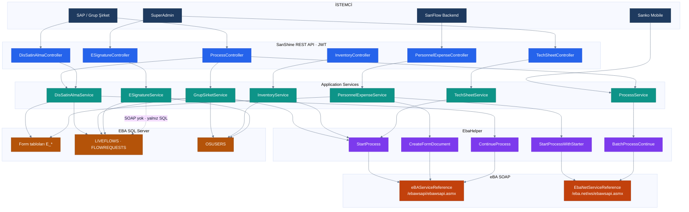

### Katmanlar

| Renk | Katman | Proje | Görev |
|:----:|---|---|---|
|  | İstemci | SAP · SanFlow · Mobil | İş tetikleyici |
|  | Web API | `SanShine.Saas.Core.WebApi` | Route, JWT, rol |
|  | Application | `SanShine.SaaS.Core.Application` | Validasyon + iş kuralı |
|  | Contract | `EbaHelper` | SOAP facade |
|  | SOAP | `eBAServiceReference` / `EbaNetServiceReference` | eBA motoru |
|  | SQL | `SanShine.SaaS.Core.Infrastucture` | Form + kullanıcı + flow |

---

## 2. Renkli süreç haritası

Hangi endpoint hangi eBA projesini, hangi kalıpla tetikler.

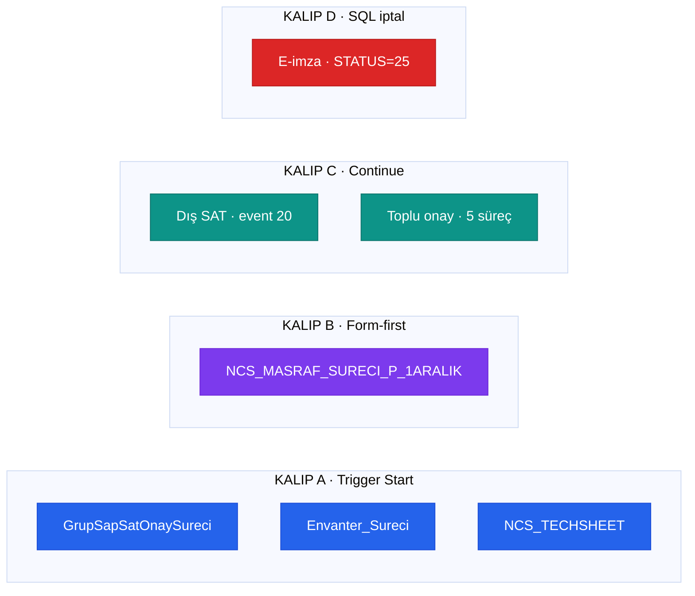

> [!IMPORTANT]
> **Dış satın alma başlatma endpoint’i bu API’de yok.** Süreç eBA içinde (veya başka kanalda) açılmış kabul edilir; burası yalnızca **devam** ve **malzeme parametresi** ekler.

---

## 3. İki SOAP yüzeyi

Aynı eBA ürününün iki WSDL’i bağlıdır. Yanlış client = starter / onaycı kaybolur.

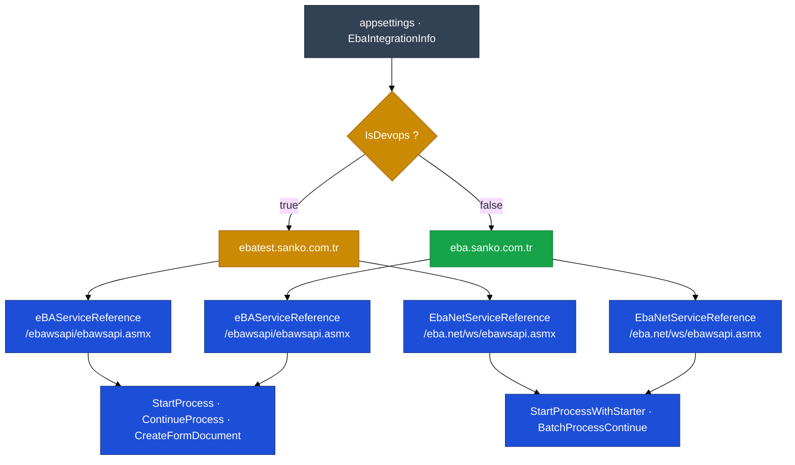

| Proxy | Namespace | Ne zaman | Kimlik |
|---|---|---|---|
| **Klasik eBA** | `eBAServiceReference` | Süreç servis hesabı adına açılsın | `UserId` + `Password` + `Language` |
| **eBA.net** | `EbaNetServiceReference` | Süreç **gerçek kullanıcı** adına açılsın / onaylansın | Aynı + `targetUser` |

### Config anahtarları

`EbaIntegrationInfo` (değerler secret store’da tutulmalı; düz metin appsettings üretim için uygun değil):

| Anahtar | Anlam |
|---|---|
| `UserId` | eBA servis / entegrasyon hesabı |
| `Password` | Servis hesabı şifresi |
| `Language` | SOAP dil parametresi (`English`) |
| `Domain` | Klasik `ebawsapi` URL |
| `IsDevops` | `true` → test endpoint (`ebawsapiSoapDev12`) |

| Ortam | SQL | SOAP host |
|---|---|---|
| Production | `SNKSQLFNS` / `EBA` | `eba.sanko.com.tr` |
| Development | `SNKSQLFNS.sankoholding.local` / `EBATEST` | `ebatest.sanko.com.tr` |

API tarafı JWT (`Program.cs`); eBA tarafı her SOAP çağrısında servis hesabı. Token yenileme / OAuth yok.

---

## 4. EbaHelper çekirdek API

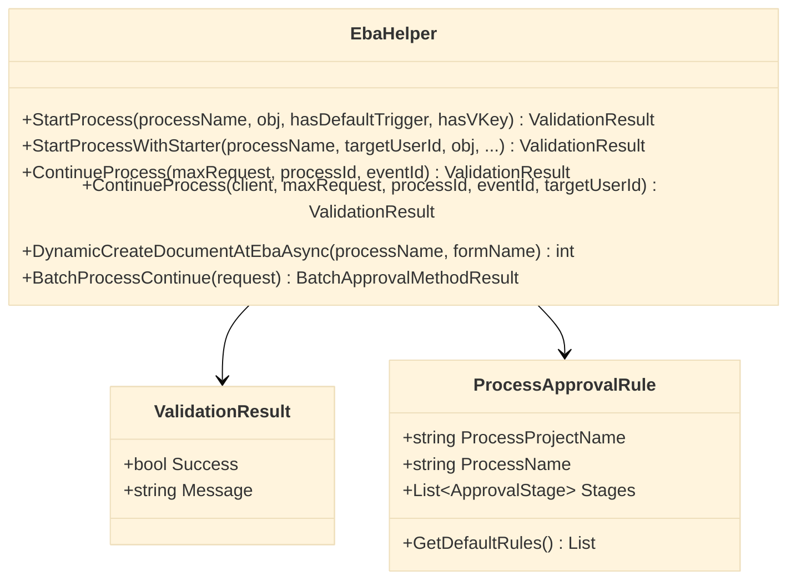

### 4.1 `StartProcess` — reflection → `V_*`

Varsayılan: `hasDefaultTriggerValue = true`, `triggerValuesHasVKey = true`.

```text
obj.Property  ──►  WorkflowParameter { name: "V_{Property}", value: ToString() }
                   +  V_IsTriggered = "1"
                   ──►  StartProcessAsync(UserId, Password, Language, processName, params)
```

- `null` / boş property **gönderilmez**.
- Nested object / liste **desteklenmez** (sadece skaler `ToString()`).
- Başarıda `Message` = eBA `ProcessId`.
- Starter her zaman **servis hesabı**dır.

Kullanan: Grup şirket SAT · Envanter · TechSheet.

### 4.2 `StartProcessWithStarter` — eBA.net

```text
StartProcessAsync(UserId, Password, targetUserId, Language, WorkflowStartParameters)
```

Süreç `targetUserId` adına açılır. Masraf: `creatorUserDetails.EmployeeID`.

### 4.3 `ContinueProcess`

| Overload | Client | Kullanım |
|---|---|---|
| `(maxRequest, processId, eventId)` | Klasik + `LoginToken` | Dış SAT |
| `(client, maxRequest, processId, eventId, targetUserId)` | eBA.net, açık client | Toplu onay |

```text
ContinueProcessWithValidation(processId, requestId, eventId, reason="")
```

`eventId` = eBA formundaki buton id (ör. `20` = SAP cevap sonrası ilerlet).

### 4.4 `DynamicCreateDocumentAtEbaAsync`

Süreç başlamadan boş form belgesi üretir → `documentId`.

```text
LoginAsync → CreateFormDocumentAsync(loginToken, processName, formName)
```

Masraf: ana form `"Form"`, alt form `"DTY"`.

---

## 5. Dört tetikleme kalıbı

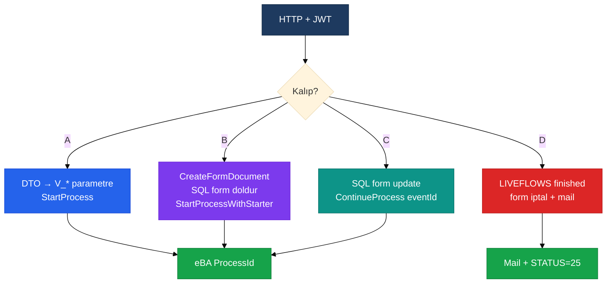

| Kalıp | Ad | SOAP | SQL | Örnek |
|:-----:|---|:----:|:---:|---|
| **A** | Trigger start | `StartProcess` | Kullanıcı / mükerrer kontrol | SAT, Envanter, TechSheet |
| **B** | Form-first | `CreateForm` + `StartProcessWithStarter` | Ana + alt form yazımı | Personel masraf |
| **C** | Continue | `ContinueProcessWithValidation` | Form update + `MaxRequestId` | Dış SAT, toplu onay |
| **D** | Soft cancel | — | `LIVEFLOWS` + form + log | E-imza iptal |

> [!WARNING]
> Kalıp B ve C’de **SQL ile SOAP aynı transaction değildir.** Form yazılır, SOAP fail ederse eBA’da yarım belge kalır. Retry / Polly yok.

---

## 6. Süreç akışları

### 6.1 Grup şirket SAP SAT onay — Kalıp A

`POST /api/rest/start-process-grup-sirket` · JWT

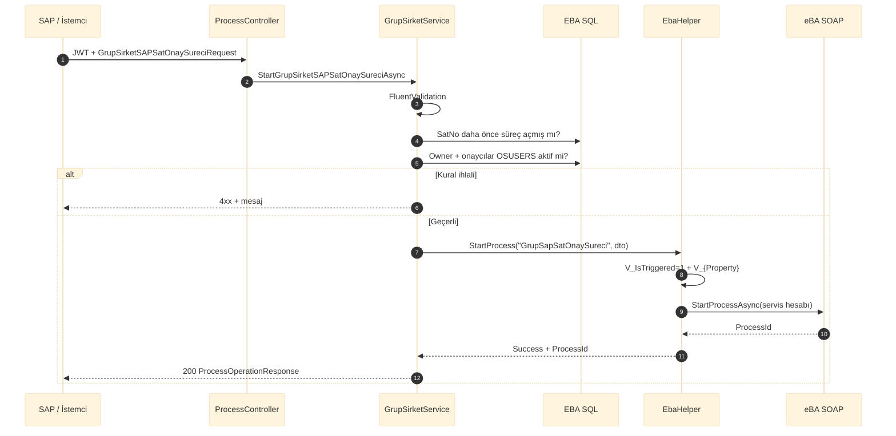

**İş kuralları**

- `GroupCompanySatNo` → `E_GrupSapSatOnaySureci_Form` + `LIVEFLOWS` mükerrer kontrolü
- `RequestOwnerUserId` eBA’da aktif
- `ApproversUserId` (`;` ayrılmış) hepsi eBA’da aktif

**eBA parametreleri:** `V_IsTriggered`, `V_ApproversUserId`, `V_RequestOwnerUserId`, `V_GroupCompanySatNo`, `V_GroupCompany`, `V_GroupCompanyDescription`, `V_GroupCompanyMaterial`, `V_GroupCompanyMaterialDescription`, `V_HoldingSatMaterial`, `V_HoldingSatMaterialDescription`, `V_Currency`, `V_BidPrice`, `V_BidAmount`, `V_BidUnit`

---

### 6.2 Envanter — Kalıp A

`POST /api/rest/start-inventory-process` · JWT

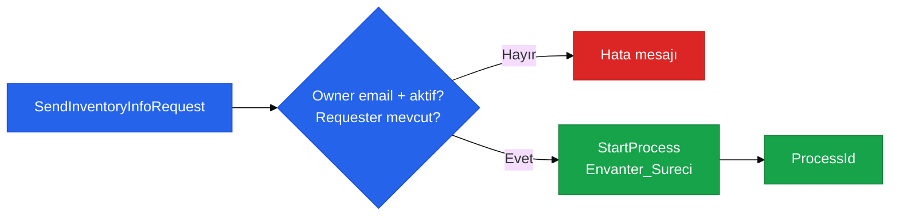

Parametreler: `V_IsTriggered`, `V_RequesterUserId`, `V_OwnerUserId`, `V_Brand`, `V_Model`, `V_SerialNumber`

Liste: `GET /api/rest/get-all-inventory-processes` → `E_Envanter_Sureci_Form` + `LIVEFLOWS` (süreç tetiklemez).

---

### 6.3 Personel masraf — Kalıp B

`POST /api/rest/create-employee-expense-process` · JWT + **`sanflow-backend`**

En karmaşık orkestrasyon: form belgesi SOAP’ta açılır, içerik SQL ile basılır, süreç **oluşturan kullanıcı** adına başlar.

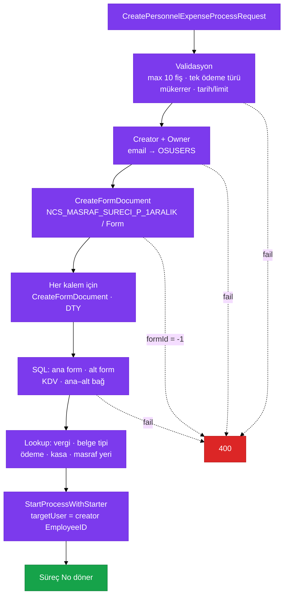

**Ödeme türü haritası**

| CustomField | İç kod | Ana form | Alt form |
|---|---|---|---|
| `Vault` | `VAULT` | Kasa Ödemesi `05` | Kasa `05` |
| `CreditCard` | `CREDIT_CARD` | Şirket Kredi Kartı `02` | Şirket Kredi Kartı `01` |
| *(yok)* | `CASH` | Cari Hesap `01` | Cari Hesap `03` |

**SOAP start parametreleri**

| Parametre | Kaynak |
|---|---|
| `V_IsTriggered` | `"1"` |
| `V_CreatedFromApiMainFormId` | `CreateFormDocument` → `mainFormId` |
| `V_CuzdanGroupFormId` | `processRequest.GroupId` |

> [!CAUTION]
> Formlar açılıp süreç patlarsa **orphan form** kalır. Kodda rollback yoktur.

---

### 6.4 Teknik föy revize — Kalıp A (prefix yok)

`POST /api/rest/techsheet-pdf-revise-for-duplicate-test-data` · **`SuperAdmin`**

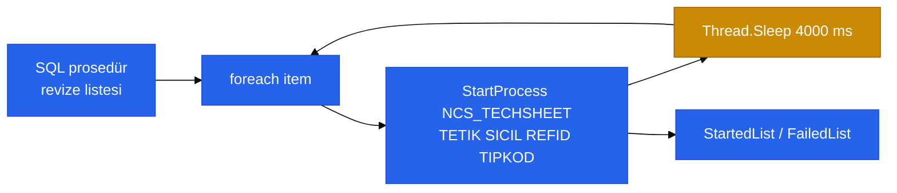

Çağrı **bilinçli olarak** prefix’siz:

```csharp
EbaHelper.StartProcess("NCS_TECHSHEET", new {
    TETIK = "2",
    SICIL = item.CreatedBy,
    REFID = item.MasterFormId,
    TIPKOD = item.ArticleNumber
}, hasDefaultTriggerValue: false, triggerValuesHasVKey: false);
```

| Alan | eBA adı | Not |
|---|---|---|
| `TETIK` | `TETIK` | `"2"` = revize tetik |
| `SICIL` | `SICIL` | Formu oluşturan |
| `REFID` | `REFID` | Master form id |
| `TIPKOD` | `TIPKOD` | Article number |
| — | `V_IsTriggered` | **gönderilmez** |

4 sn bekleme eBA yükünü sınırlar. Tekil article revize (`StartProcessToTechSheetRevise`) endpoint’i **yorumda**, gövde TODO.

---

### 6.5 Dış satın alma devam — Kalıp C

`POST /api/rest/continue-process-dis-satin-alma` · JWT

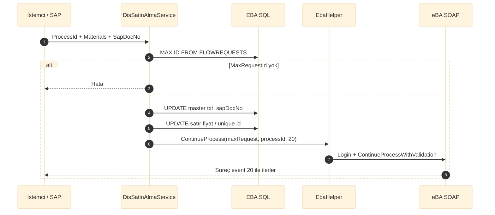

| DTO | eBA kolon |
|---|---|
| `SapDocNo` | `E_DisSatinAlmaSureci_Form.txt_sapDocNo` |
| `Materials[].ProfitablePrice` | `txt_profitablePrice` |
| `Materials[].TotalPrice` | `txt_totalPrice` |
| `Materials[].SapMaterialUniqueId` | `txt_sapMaterialUniqueId` |
| `RequirementNumber` + `MaterialUniqueId` | WHERE |

`POST /api/rest/add-material-dis-satin-alma` süreç **açmaz**; `E_DisSatinAlmaSureci_Prm_Materials_tbl_materials` insert eder.

---

### 6.6 Toplu onay — Kalıp C (eBA.net)

`POST /api/rest/batch-approval` · JWT + **`sanko-mobile`**

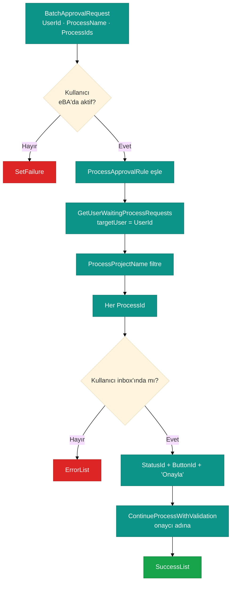

`ProcessName` = **proje kodu** (`NCS_MASRAF_SURECI_P_1ARALIK`), görünen ad değil. Tanımsız ad reddedilir. Tek süreç hatası diğerlerini durdurmaz.

---

### 6.7 E-imza iptal — Kalıp D

`POST /api/rest/e-signature/process/cancel` · **`SuperAdmin`** veya **`e-signature`**

SOAP `CancelProcess` **yok**.

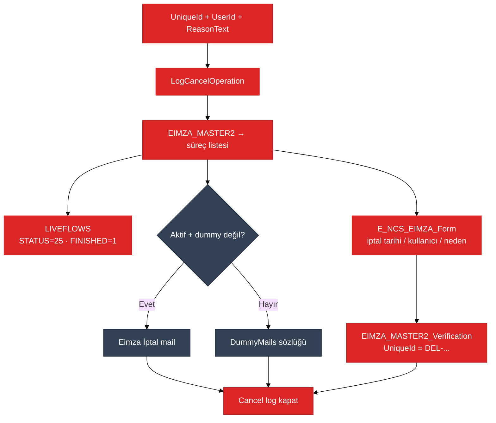

Kritik SQL:

```sql
UPDATE LIVEFLOWS SET STATUS = 25, FINISHED = 1 WHERE ID = @id;
```

---

## 7. HTTP endpoint kataloğu

| Method | Path | Rol | Kalıp | eBA süreç / işlem |
|:------:|---|---|:-----:|---|
| `POST` | `/api/rest/start-process-grup-sirket` | JWT | A | `GrupSapSatOnaySureci` |
| `POST` | `/api/rest/start-inventory-process` | JWT | A | `Envanter_Sureci` |
| `POST` | `/api/rest/create-employee-expense-process` | `sanflow-backend` | B | `NCS_MASRAF_SURECI_P_1ARALIK` |
| `POST` | `/api/rest/techsheet-pdf-revise-for-duplicate-test-data` | `SuperAdmin` | A | `NCS_TECHSHEET` |
| `POST` | `/api/rest/continue-process-dis-satin-alma` | JWT | C | mevcut `processId` · event `20` |
| `POST` | `/api/rest/batch-approval` | `sanko-mobile` | C | kural tablosundaki 5 süreç |
| `POST` | `/api/rest/e-signature/process/cancel` | `e-signature` | D | uniqueId altındaki süreçler |
| `POST` | `/api/rest/add-material-dis-satin-alma` | JWT | — | parametre tablosu, süreç yok |

Swagger (lokal): `https://localhost:7191/swagger`

---

## 8. Trigger parametre sözleşmesi

eBA proje script’i (`OnProcessStart` / trigger) şu sözleşmeyi okumalıdır.

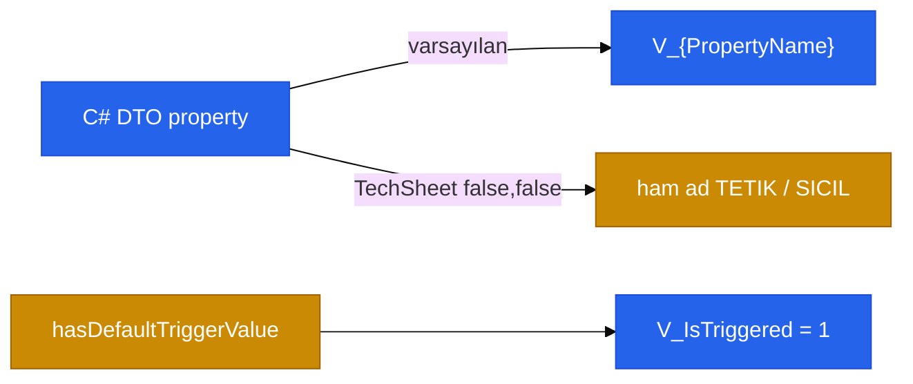

| Senaryo | Prefix | `V_IsTriggered` | Starter |
|---|---|---|---|
| SAT / Envanter | `V_` | evet | Servis hesabı |
| Masraf | `V_` | evet | **Gerçek kullanıcı** (`EmployeeID`) |
| TechSheet | yok | hayır | Servis hesabı |

eBA form designer’da **event / status id değişirse** API kırılır (`20`, `5`, `21` kodda magic number).

---

## 9. Toplu onay kuralları

`ProcessApprovalRule.GetDefaultRules()` — `EbaHelper.cs`

| `ProcessName` (istek) | Görünen ad | Aşama | ButtonId | StatusId |
|---|---|---|:--------:|:--------:|
| `NCS_MASRAF_SURECI_P_1ARALIK` | Personel Masraf | Yönetici | `5` | `21` |
| `NCS_MASRAF_SURECI_P_1ARALIK` | Personel Masraf | Akış Başlatan | `5` | `28` |
| `NCS_MASRAF_SURECI_SIRKET` | Şirket Masraf | Yönetici | `21` | `28` |
| `SapSatOnaySureci` | SAP Satın Alma Onay | Yönetici | `20` | `20` |
| `SeyahatFormu` | Görev Seyahat Talep | Yönetici | `5` | `31` |
| `izin_sureci` | İzin Talep | Yönetici | `5` | `37` |

Eşleşme: bekleyen request’in `Status.Id` + event `Id` + event `Text == "Onayla"`.

---

## 10. Hata, log ve tutarlılık

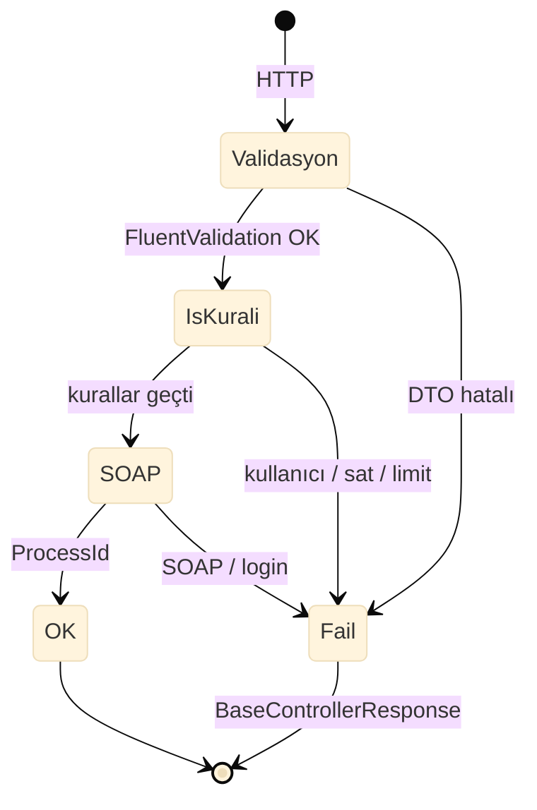

| Konu | Davranış |
|---|---|
| SOAP hata | `ValidationResult.Success = false` + dosya log |
| Toplu onay | Kısmi başarı: `SuccessList` / `ErrorList` |
| TechSheet döngü | Kısmi: `StartedList` / `FailedList` |
| HTTP map | `CustomBaseController.HandleServiceResponse` |
| Retry | **Yok** |
| Dağıtık TX | **Yok** (SQL + SOAP ayrı) |
| Log | `Logs/{Yıl}/{Ay}/Api Çalışma Logs/` · masraf: `CuzdanIntegration_Logs` · föy: `TechSheet_Logs` |

Dokunan başlıca tablolar: `LIVEFLOWS`, `FLOWREQUESTS`, `FLOWDOCUMENTS`, `OSUSERS`, `E_GrupSapSatOnaySureci_Form`, `E_Envanter_Sureci_Form`, `E_DisSatinAlmaSureci_*`, `E_NCS_MASRAF_SURECI_P_1ARALIK_*`, `E_NCS_EIMZA_Form`, `EIMZA_MASTER2*`.

---

## 11. Yeni süreç ekleme

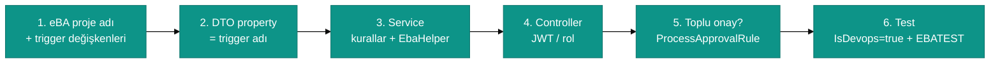

**Karar ağacı**

| İhtiyaç | Kullan |
|---|---|
| Servis hesabı başlatsın, form eBA script’te dolsun | `StartProcess` · Kalıp A |
| Formu API doldursun, süreç kullanıcı adına açılsın | `CreateFormDocument` + `StartProcessWithStarter` · Kalıp B |
| Zaten açık süreçte butona basılsın | `ContinueProcess` · Kalıp C |
| Onaycı adına inbox’tan ilerletilsin | `BatchProcessContinue` + kural satırı |
| Süreci eBA motoru olmadan bitsin | SQL `LIVEFLOWS` · Kalıp D — dikkatli kullan |

---

## Referans dosyalar

| Dosya | Rol |
|---|---|
| `SanShine.SaaS.Core.Contract/Shared/EbaHelper.cs` | SOAP facade + onay kuralları |
| `SanShine.SaaS.Core.Common/Constants/EbaIntegrationInfo.cs` | Config modeli |
| `SanShine.Saas.Core.WebApi/Controllers/ProcessController.cs` | SAT start · SAT continue · batch |
| `SanShine.SaaS.Core.Application/Services/IGrupSirketSAPSatOnaySureciService.cs` | SAT iş kuralları |
| `SanShine.SaaS.Core.Application/Services/IDisSatinAlmaService.cs` | Continue + malzeme |
| `SanShine.SaaS.Core.Application/Services/IPersonnelExpenseService.cs` | Form-first masraf |
| `SanShine.SaaS.Core.Application/Services/IInventoryService.cs` | Envanter start |
| `SanShine.SaaS.Core.Application/Services/ITechSheetService.cs` | Föy revize döngüsü |
| `SanShine.SaaS.Core.Application/Services/IESignatureService.cs` | SQL iptal |
| `SanShine.SaaS.Core.Application/Services/IProcessService.cs` | Toplu onay orkestrasyonu |

---

*Kaynak: kod tabanı (`EbaHelper`, controller ve service katmanı). eBA form script’leri bu repoda değildir; trigger adları ve event id’ler eBA projesiyle senkron tutulmalıdır.*
